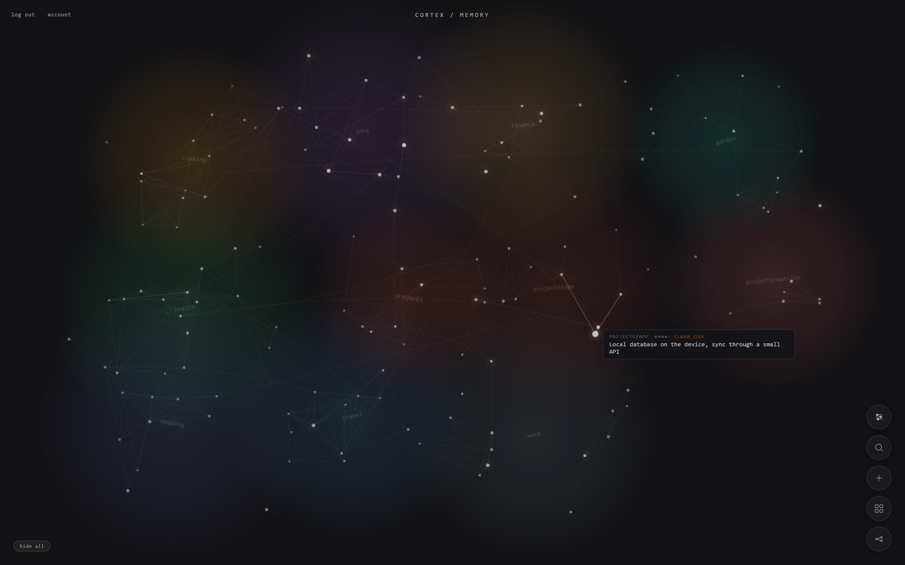

# Cortex

A shared memory for your AI assistants. Claude, Perplexity or anything else that speaks MCP reads and writes the same store, so a new conversation starts with what the last one learned.

## What it is

- **A memory you can see.** Notes live in clusters, one per part of your life or work, split into sections. The web app draws them as a graph and lets you edit any note in place.
- **Notes with weight.** Every note carries an importance from 1 to 5, a date, the assistant it came from and a stable id. Advice an assistant gives is kept as a recommendation, not a fact, until you accept it.
- **Cheap for an AI to read.** A briefing returns the notes that matter for a topic, ranked by relevance, importance and age, within a token budget. An outline maps a whole cluster in a few lines.
- **Careful for an AI to write.** Tools to save, edit, move, link and re-rank notes, so the memory gets corrected instead of piling up.

## How it's made

One HTML file is the whole interface. Behind it: a small Flask app, MongoDB for storage, and an MCP server that runs over stdio on your machine or as plain JSON-RPC over HTTP on Vercel. Every user has their own key and their own memory.

| File | |
|---|---|
| `index.html` | the web app |
| `app.py` | backend for the web app |
| `mcp_server.py` | the MCP tools |
| `recall.py` | what a briefing picks and how it ranks |
| `api/` | Vercel entry points |
| `db.py` | storage |

MIT licensed. Take what's useful.
